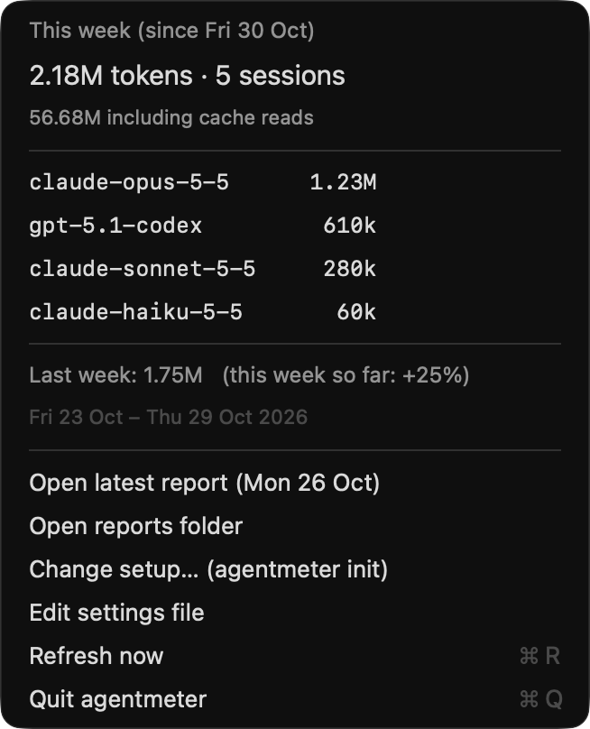

# agentmeter


**How many tokens did your coding agents use this week?**

agentmeter reads the session logs your coding tools already keep on your machine and shows your token usage per model, week by week, compared with the week before. Nothing leaves your machine: no network, no API keys, no accounts.




_Screenshots use demo data._

## Install

macOS and Linux. Needs Python 3.9+; nothing else to install.

```sh
xcode-select --install       # macOS only, once: provides python3 and swiftc
git clone https://github.com/tusharjayanti/agentmeter
cd agentmeter
./install.sh
```

The installer asks a few questions (your tools, and when your week starts), then sets up:

- the `agentmeter` command, in `~/.local/bin`
- a report job that saves each finished week (runs hourly and at login; does nothing until a week ends)
- on macOS, the menu bar item, started at login. On Linux: a GNOME top-bar plugin ([Argos](https://github.com/p-e-w/argos)), or `agentmeter --status` for Waybar, Polybar or tmux ([snippets](docs/configuration.md#linux-status-bars))

Change your answers any time with `agentmeter init`, or **Change setup…** in the menu.

## Use

```sh
agentmeter                    # the last 4 weeks, per model
agentmeter --today            # any time range: --since 6h, --since 3d, --from 2026-10-01 --to 2026-10-15
agentmeter --period last      # one week: this, last, or any date in it
agentmeter --status           # one line for a status bar: TOKENS 1.13M
agentmeter check              # check your config and see how your logs are read
```

## Weekly report

When a week ends, a report is saved to `~/.local/share/agentmeter/reports/` as Markdown to read and JSON for scripts:

```
# agentmeter: Fri 30 Oct – Thu 5 Nov 2026

2.18M tokens this week · 5 sessions
Previous week (Fri 23 Oct – Thu 29 Oct 2026): 1.75M · +25%

| model             | tool        | tokens | previous week | change |
| claude-opus-5-5   | claude-code |  1.23M |          900k |   +37% |
| gpt-5.1-codex     | codex       |   610k |          520k |   +17% |
| claude-sonnet-5-5 | claude-code |   280k |          330k |   -15% |
| claude-haiku-5-5  | claude-code |    60k |             0 |    new |
```

Reports are written once and never recomputed, because tools delete old logs (Claude Code after 30 days). The saved reports are your history.

"Tokens" means fresh tokens: input, cache writes and output. Cache reads (the model re-reading the conversation, billed at a fraction of the price) are shown separately.

## Configure

Setup writes `~/.config/agentmeter/config.json`. The settings you're most likely to change:

| Setting | Default | What it does |
|---|---|---|
| `period` | `{"start": null, "length": "1w"}` | when collection begins, and how long each window is: `1w`, `2w`, `1m`, `10d`… |
| `tools` | every tool with logs | which tools to read |
| `widget` | `{"style": "stacked"}` | the menu bar look; `"icon"` shows an icon and the number |
| `routing` | `false` | also flag sessions where an expensive model did routine work |

Everything else is in [docs/configuration.md](docs/configuration.md).

## Supported tools

| Tool | Status |
|---|---|
| Claude Code | tested on real logs |
| OpenAI Codex CLI, Gemini CLI, Aider | built from their documented formats, tested on sample files only |
| Anything else | export to a [simple JSONL format](docs/adapters.md#your-own-tool) |

## Help wanted

- **Linux users:** the installer, the GNOME plugin and the Waybar/Polybar output have only run in CI. Try it and [open an issue](https://github.com/tusharjayanti/agentmeter/issues) with what you find.
- **Codex CLI, Gemini CLI and Aider users:** does `agentmeter` read your logs correctly?
- **New tools:** Cursor, GitHub Copilot CLI and OpenCode need an adapter, one file each ([how](docs/adapters.md#writing-an-adapter)).

Run the tests with `python3 -m pytest -q tests`.

## License

MIT
