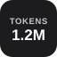
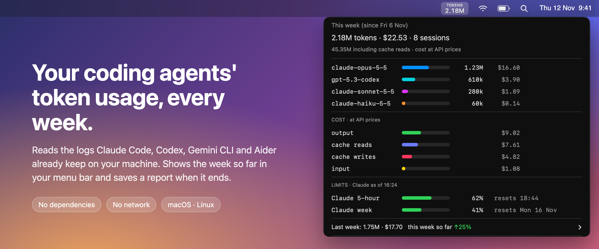
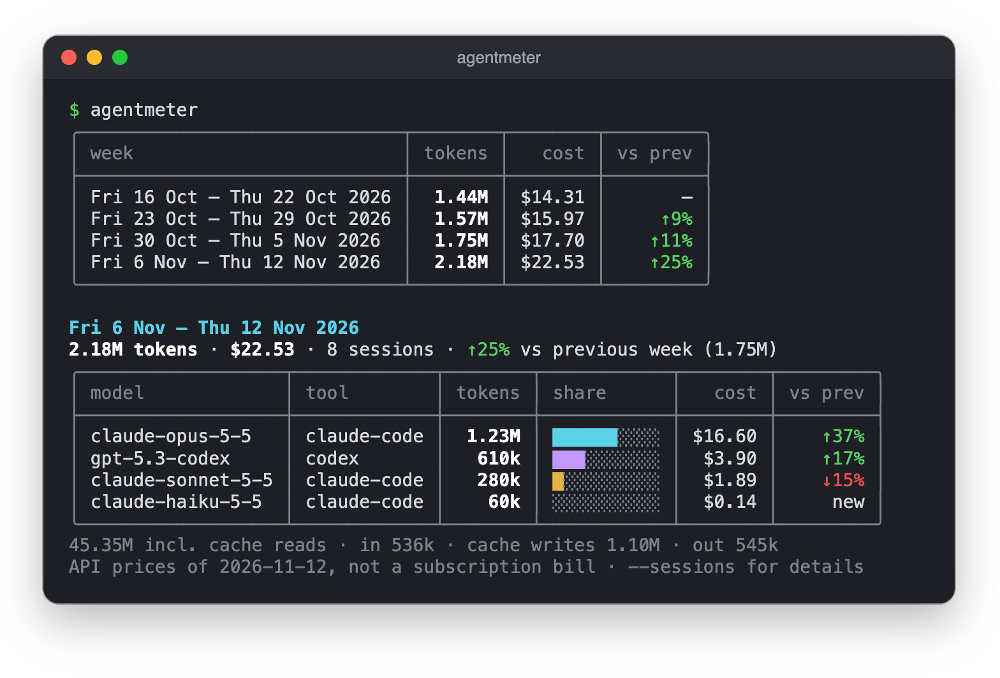
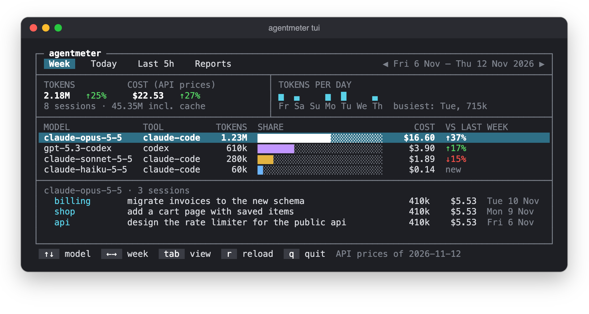
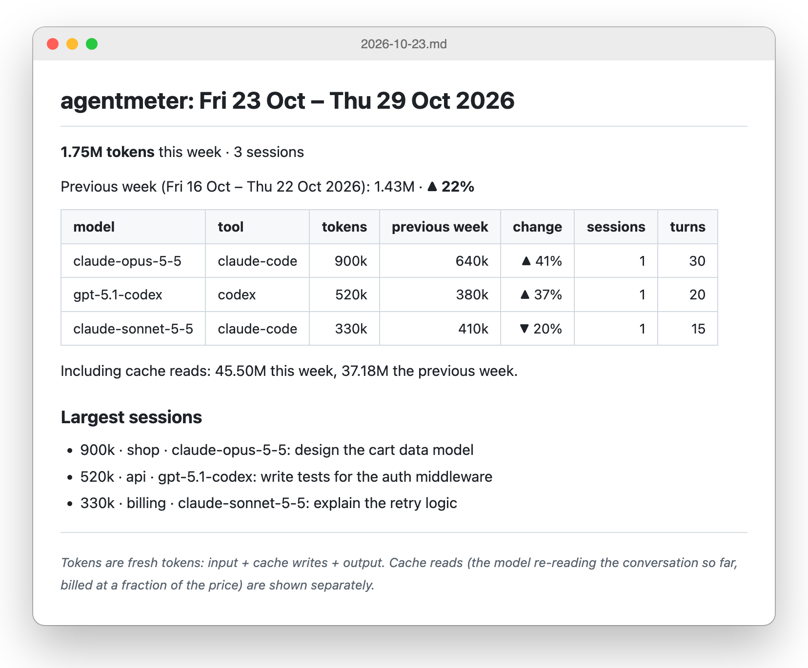

<p align="center">
  
</p>

<h1 align="center">agentmeter</h1>

<p align="center"><strong>Your coding agents' token usage, every week.</strong></p>

<p align="center">
  <a href="https://github.com/tusharjayanti/agentmeter/actions/workflows/tests.yml"></a>
  
  
  
  <a href="LICENSE"></a>
</p>

<p align="center">
  
</p>

<p align="center"><sub>Screenshots use demo data.</sub></p>

## The problem

You use Claude Code, Codex or Gemini CLI every day, and you can't easily answer: how many tokens did I use this week? On which models? What would that cost at API prices? More or less than last week?

The answer is already on your disk. Every one of these tools writes a session log with every model call and its token counts. agentmeter reads those logs and turns them into a number in your menu bar and a report at the end of every week. Nothing leaves your machine.

## Get started

```sh
git clone https://github.com/tusharjayanti/agentmeter
cd agentmeter
./install.sh
```

The installer asks which tools you use and when your week starts, then sets up three things:

- the `agentmeter` command, in `~/.local/bin`
- a background job that saves a report when each week ends
- on macOS, the menu bar item, started at login

It needs Python 3.9 or newer and nothing else. On a Mac without developer tools, run `xcode-select --install` first: it provides Python and the compiler for the menu bar app.

## Always in view

The menu bar shows the week's tokens so far. Click it for the cost, your plan's 5-hour and weekly limits, the breakdown by model, last week's total, and the latest report. [What each part of the menu means](docs/menu.md).

On Linux, the same number goes in your top bar: a GNOME extension through [Argos](https://github.com/p-e-w/argos), or one line for Waybar, Polybar or tmux ([snippets](docs/configuration.md#linux-status-bars)).

## Any range, any time

<p align="center">
  
</p>

```sh
agentmeter                     # the last 4 weeks, then this week per model, with cost
agentmeter tui                 # full screen: flip through weeks, today, the last 5 hours, reports
agentmeter --today             # or --since 6h, --since 3d, --from 2026-10-01 --to 2026-10-15
agentmeter --period last       # one week: this, last, or any date in it; --sessions for the largest sessions
agentmeter --json              # everything, for your own scripts
```

<p align="center">
  
</p>

Cost is what the tokens would cost at each vendor's API list prices, bundled and dated in the code. On a subscription it isn't your bill, but it's a fair way to compare weeks and models. [How it's worked out](docs/configuration.md#cost-prices).

Plan limits (Claude's and Codex's 5-hour and weekly) come from the copy each tool already keeps on disk, so agentmeter still never goes online. [Details](docs/configuration.md#plan-limits).

## A report every week

<p align="center">
  
</p>

When a week ends, agentmeter saves it to `~/.local/share/agentmeter/reports/`, as Markdown to read and JSON for scripts. Reports are written once and kept. Claude Code deletes its logs after 30 days, so the saved reports become your history.

"Tokens" means fresh tokens: input, cache writes and output. Cache reads, where the model re-reads the conversation at a fraction of the price, are counted separately.

## Make it yours

Change your answers any time with `agentmeter init`, or **Change setup…** in the menu.

| Setting | What it does |
|---|---|
| `period` | when collection begins, and how long a window is: a week from any day, two weeks, a month, ten days |
| `tools` | which tools to read |
| `widget` | the menu bar look: a caption over the number, or an icon beside it |
| `prices` | add or correct a model's price |
| `routing` | optional: flag sessions where an expensive model did routine work |

Every setting, the full command line and uninstall steps are in [docs/configuration.md](docs/configuration.md).

## Why agentmeter

- **Nothing to install.** About 2,400 lines of standard-library Python, plus one Swift file for the menu bar. No Node, no pip, no Electron.
- **No network.** It never connects to anything: no telemetry, no update checks, no price downloads (prices ship with the code).
- **Your history is plain files.** One Markdown and one JSON file per week, readable without agentmeter.

## Works with

| Tool | Status |
|---|---|
| Claude Code | tested on real logs |
| OpenAI Codex CLI, Gemini CLI, Aider | built from their documented formats; tested on sample files only |
| Anything else | export to a [simple JSONL format](docs/adapters.md#your-own-tool) |

## Help wanted

- **Linux users:** the installer and top-bar output have only run in CI. Try it and [open an issue](https://github.com/tusharjayanti/agentmeter/issues) with what you find.
- **Codex CLI, Gemini CLI and Aider users:** tell us whether your logs are read correctly.
- **More tools:** Cursor, GitHub Copilot CLI and OpenCode each need one adapter file ([how](docs/adapters.md#writing-an-adapter)).

Run the tests with `python3 -m pytest -q tests`.

## License

[MIT](LICENSE)
