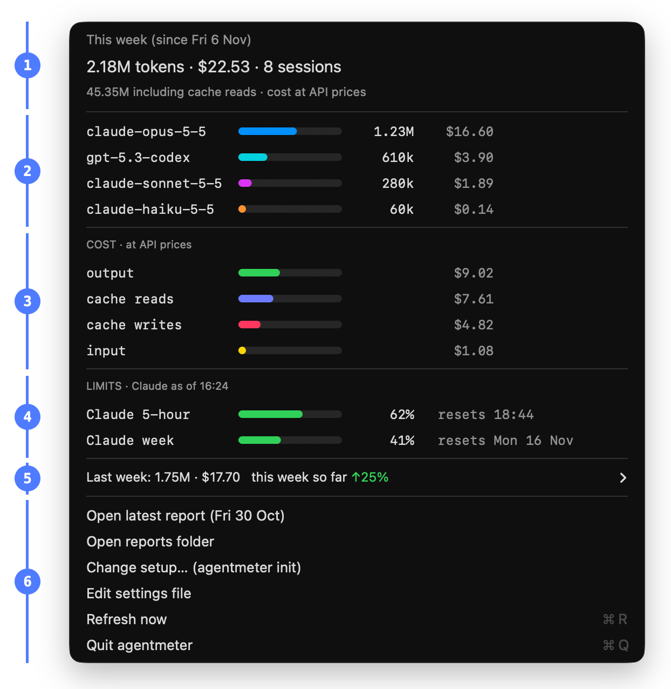

# The menu, part by part

What you see when you click **TOKENS** in the menu bar. The screenshot uses demo data (made-up projects, made-up limits), so the figures are examples. Each number matches a section below.

<p align="center">
  
</p>

## 1. This week at a glance

```
This week (since Fri 6 Nov)
2.18M tokens · $22.53 · 8 sessions
45.35M including cache reads · cost at API prices
```

- **Window:** your measurement window from settings (`period`). Here it is weeks starting on Friday.
- **Tokens:** fresh tokens: input, cache writes and output. The same number as the **TOKENS** label in the menu bar.
- **Cost:** what those calls would cost at the vendors' published API prices. On a Pro or Max subscription it is not your bill; it is the pay-as-you-go equivalent, useful for comparing weeks. See [Cost](configuration.md#cost-prices).
- **Sessions:** distinct coding sessions this week. A session that used two models counts once.
- **Grey line:** the total if you add cache reads, the cheap re-reading of the conversation so far. They are left out of the headline on purpose: on Claude Code they are usually over 90% of all tokens.
- **Click:** opens this week's full breakdown in Terminal.

## 2. Models

```
claude-opus-5-5     ██████────   1.23M   $16.60
gpt-5.3-codex       ███───────    610k    $3.90
```

- **Bar:** each model's share of this week's tokens. Models are sorted largest first, and each keeps its colour in the last-week submenu.
- **Tokens:** that model's fresh tokens this week, across every tool that used it (Claude Code, Codex, Gemini CLI, Aider).
- **Cost:** that model's cost at its own price. The rows add up to the headline: $16.60 + $3.90 + $1.89 + $0.14 = $22.53.
- **Click:** opens the breakdown in Terminal. Hover for the tool and session count.

A model with no published price shows `–` instead of a guess. Add its price under `prices` in settings.

## 3. What the cost is made of

```
COST · at API prices
output         ████──────   $9.02
cache reads    ███───────   $7.61
```

The same $22.53, split by kind of token instead of by model, largest first. The rows add up to the headline.

- **Output:** text and code the model wrote, including thinking. The most expensive kind per token.
- **Cache reads:** the model re-reading the conversation so far. Very cheap per token, but there are so many that they add up.
- **Cache writes:** putting new context into the cache. Claude charges 1.25× the input price for the 5-minute cache and 2× for the 1-hour cache.
- **Input:** prompt tokens that weren't cached.

The split is there so the cost can be checked by hand. It also shows why a week can cost more than its token count suggests: much of the money often goes on cache reads and writes.

## 4. Plan limits

```
LIMITS · Claude as of 16:24
Claude 5-hour   ██████────   62%   resets 18:44
Claude week     ████──────   41%   resets Mon 16 Nov
```

- **Bar:** how much of each subscription limit you have used, 0 to 100%. The same figures as Claude Code's `/usage`.
- **Resets:** when that limit starts over: a time if it is today, otherwise a date.
- **As of:** when the reading was taken. agentmeter never goes online. For Claude it reads the copy Claude Code saves in `~/.claude.json`; for Codex, the limits written into its session logs. Opening `/usage` in Claude Code refreshes Claude's reading.
- **Colour:** green below 70%, orange from 70%, red from 90%. Grey, with "reset since", once the reset time has passed and the reading is out of date.

API-key users have no plan limits, so this part is left out for them. See [Plan limits](configuration.md#plan-limits).

## 5. Last week

```
Last week: 1.75M · $17.70   this week so far ↑25%   ›
```

- **Figures:** last week's tokens and cost, and how this week compares so far: green ↑ for more, red ↓ for less. Early in a week the change reads low, because the week isn't over yet.
- **Submenu:** last week's models with the same bars, and a link to its saved report.

## 6. Actions

- **Open latest report:** the last finished week's report, saved as Markdown in `~/.local/share/agentmeter/reports/`. One is written for each week when it ends, and never changed after.
- **Open reports folder:** one `.md` to read and one `.json` for scripts per week.
- **Change setup…:** runs `agentmeter init` in Terminal to change tools, the week's start day and length, or model routing.
- **Edit settings file:** opens `~/.config/agentmeter/config.json`, for settings the setup questions don't ask, like extra prices.
- **Refresh now (⌘R):** re-reads the logs. The menu also refreshes every 15 minutes and each time you open it.
- **Quit (⌘Q):** closes the app until your next login.
